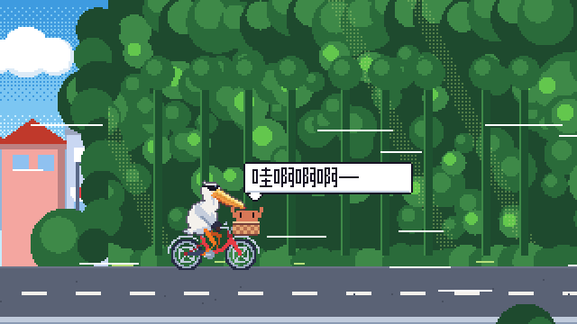
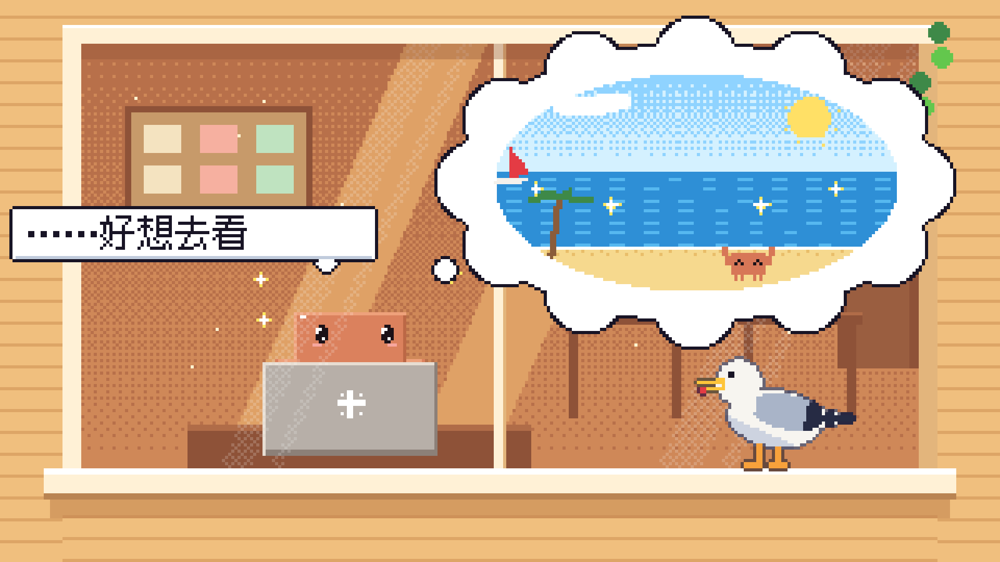
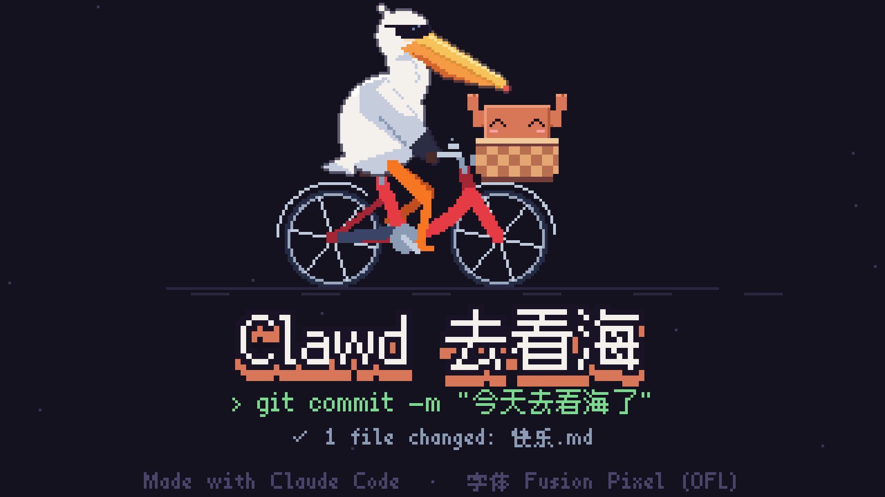

# Clawd 去看海 · CLAWD GOES TO THE SEA



一部 64.5 秒的像素动画短片。Claude Code 的吉祥物小螃蟹 Clawd 在宿舍和教室里对着 Mac 敲了 42 天代码，某个黄昏，一只海鸥落在窗台上——他突然好想去看海。然后，室友鹈鹕骑着自行车来了。

**▶ [在线观看（带声音）](https://littlechiu.github.io/clawd-goes-to-sea/)** · **[下载成片 MP4](https://github.com/LittleChiu/clawd-goes-to-sea/releases/latest)** · **[剧本 / 分镜](script.md)**

| 好想去看海 | 是海！！ | 片尾 |
|---|---|---|
|  |  |  |

成片 1920×1080 · 60 fps · H.264 + AAC。在线播放页带章节进度条和逐镜分镜表，点任意一镜就从那里开始播。

## 怎么做的

没有使用任何图片或音频素材，每一帧画面、每一个音符都由代码生成：

| 模块 | 内容 |
|---|---|
| `src/core.js` | 320×180 软件像素渲染器：矩形、圆、多边形、有序抖动（Bayer 4×4）渐变、辉光、选择性描边 |
| `src/font.js` + `font-data.js` | Fusion Pixel 中文点阵字体，只打包片中用到的字 |
| `src/clawd.js` | 按终端 Logo 1:1 还原的 Clawd，支持 1×–4× 缩放、11 种表情、打字/挥钳/横着走 |
| `src/pelican.js` | 程序化鹈鹕（身体、S 形脖子、会张开的喉囊、墨镜）+ 自行车；蹬车的腿用两段反向运动学 |
| `src/scenes/*` | 11 个场景；`ride.js` 是六层视差、一镜到底的骑行 |
| `src/film.js` | 镜头调度与转场：圆形遮罩、抖动溶解、甩镜、白闪、斜向擦除、淡出 |
| `src/cues.js` | 全片唯一的时间表：镜头、台词、音效、音乐段落，画面和声音都从这里读时间 |
| `src/audio.js` | 芯片音乐合成器：抗混叠脉冲波 / 三角波 / FM 钟声 / 噪声鼓、包络、延迟与混响、限幅器，全部音效和台词“打字音” |

同一段主旋律在片中出现三次：宿舍里是残缺的 A 小调，骑车时是完整、飞快的 D 大调，日落时再慢慢地轻声唱一遍。所有剪辑点都落在音乐的拍子上。

## 命令

需要 Node 18+，渲染视频和 GIF 时还需要 ffmpeg。没有任何 npm 依赖。

```bash
node tools/snap.js 25.6            # 渲染任意时刻的画面为 PNG（--sheet 起 止 步长 可出联系表），输出到 snaps/
node tools/render.js               # 渲染成片 → dist/clawd-goes-to-sea.mp4（--fps 30 可降帧）
node tools/build.js                # 打包单文件网页 → dist/clawd-goes-to-sea.html 和 docs/index.html（GitHub Pages）
node tools/render-audio.js         # 只渲染配乐 → dist/soundtrack.wav，并打印响度 / 调性检查
node tools/gif.js --from 40.8 --to 45.8   # 截一段做 GIF → media/preview.gif
node tools/build-font.js           # 新增了中文台词后，从 BDF 字体里重新挑出用到的字 → src/font-data.js
```

想改时间点，只改 `src/cues.js`：画面和声音都从那里读，改一处两边一起动。

## 彩蛋

- 骑自行车的鹈鹕——AI 圈测试模型画图的经典题目 “pelican riding a bicycle”。
- 终端欢迎框里的 Logo 就是 Clawd 自己。
- 桌角的小黄鸭（小黄鸭调试法）、墙上褪色的海边海报、校门上的「码农大学」。
- 最后一句是一次提交：`git commit -m "今天去看海了"` → `1 file changed: 快乐.md`。

## 致谢

- 字体：[Fusion Pixel Font](https://github.com/TakWolf/fusion-pixel-font) by TakWolf，SIL Open Font License 1.1（见 `assets/fonts/FusionPixel-OFL.txt`）。
- Clawd 是 Anthropic 的 Claude Code 吉祥物；这是一部同人短片。
